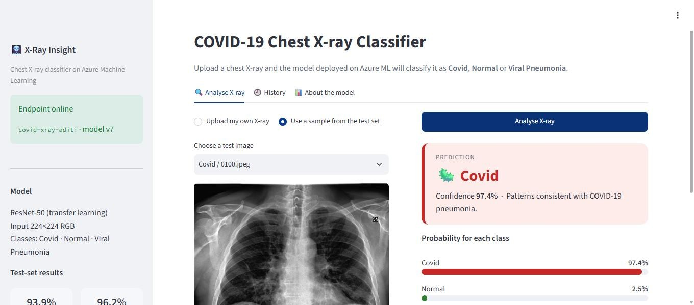
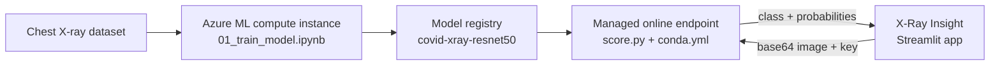
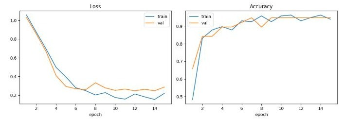
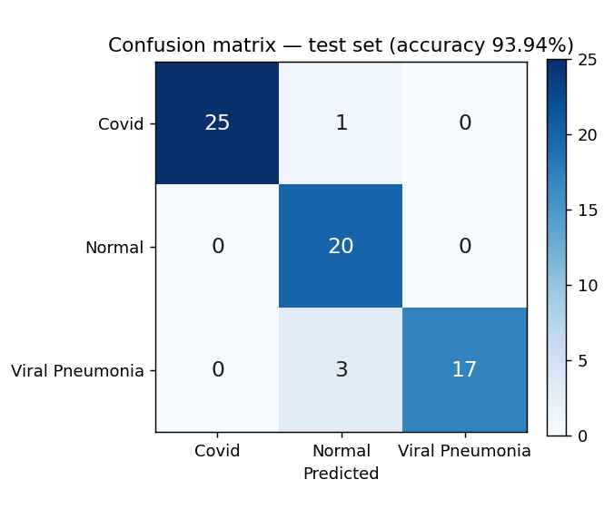
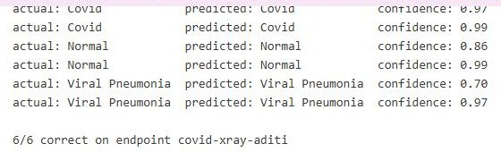
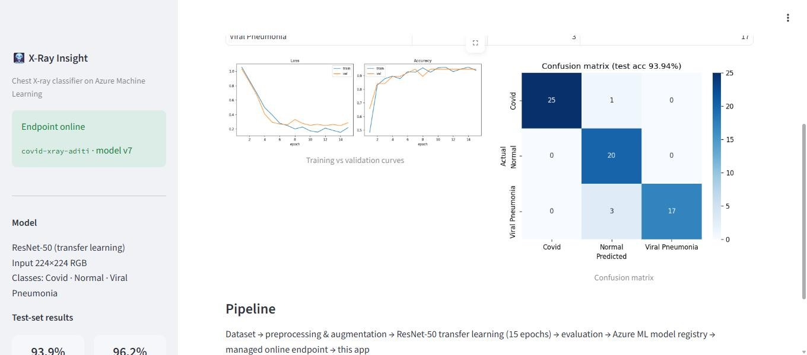

# 🩻 X-Ray Insight — COVID-19 Chest X-ray Classifier on Azure ML

An end-to-end machine learning project that classifies chest X-rays as **Covid**, **Normal** or **Viral Pneumonia**.
The model is trained and deployed on **Microsoft Azure Machine Learning** and served through a **Streamlit web app**.

| | |
|---|---|
| **Model** | ResNet-50, transfer learning (PyTorch) |
| **Test accuracy** | **93.94%** (62 / 66 unseen images) |
| **Covid recall** | **96.2%** (25 / 26) |
| **Deployment** | Azure ML managed online endpoint (REST API) |
| **UI** | Streamlit app — upload an X-ray, get the class, confidence and per-class probabilities |



> ⚠️ Educational project. It is not a medical device and must not be used for diagnosis.

---

## Architecture



1. **Train** — ResNet-50 is fine-tuned on a compute instance (`01_train_model.ipynb`).
2. **Register** — the weights and preprocessing settings are versioned in the Azure ML model registry.
3. **Deploy** — `src/score.py` runs inside a managed online endpoint and returns predictions as JSON (`02_deploy_endpoint.ipynb`).
4. **Serve** — `app/app.py` is a Streamlit UI that sends any uploaded X-ray to the endpoint.

## Dataset

[COVID-19 Image Dataset](https://www.kaggle.com/datasets/pranavraikokte/covid19-image-dataset) (Kaggle), 3 classes, already split into train and test:

| Class | Train | Test |
|---|---|---|
| Covid | 111 | 26 |
| Normal | 70 | 20 |
| Viral Pneumonia | 70 | 20 |
| **Total** | **251** | **66** |

The dataset is **not included** in this repository. Download it and place `Covid19-dataset.zip` in the repository root.
The training notebook unzips it into `Covid19-dataset/`.

## Method

- **Preprocessing:** convert to RGB (the dataset mixes grayscale, RGB and RGBA), resize to 224×224, ImageNet normalisation.
- **Augmentation (train only):** random resized crop (80–100%), rotation ±10°, brightness/contrast jitter. No horizontal flip, because a mirrored chest is anatomically wrong.
- **Transfer learning:** ResNet-50 pretrained on ImageNet. All layers are frozen except `layer4`, and the new head is `Dropout(0.3) → Linear(2048 → 3)`. That leaves 15.0M of 23.5M parameters trainable.
- **Class imbalance:** class-weighted cross-entropy (Covid 0.755, Normal 1.203, Viral Pneumonia 1.183).
- **Training:** AdamW (lr 1e-4, weight decay 1e-4), cosine LR schedule, 15 epochs, batch 16, best epoch kept by validation accuracy (15% stratified hold-out). Seed 42 makes results reproducible.

## Results

| Actual \ Predicted | Covid | Normal | Viral Pneumonia |
|---|---|---|---|
| **Covid** (26) | **25** | 1 | 0 |
| **Normal** (20) | 0 | **20** | 0 |
| **Viral Pneumonia** (20) | 0 | 3 | **17** |

| Class | Precision | Recall | F1 |
|---|---|---|---|
| Covid | 1.000 | 0.962 | 0.980 |
| Normal | 0.833 | 1.000 | 0.909 |
| Viral Pneumonia | 1.000 | 0.850 | 0.919 |

<p>
  
  
</p>

**Live endpoint test:** 6 / 6 sample images were classified correctly through the deployed REST API.



## The web app (X-Ray Insight)

- **Analyse X-ray:** upload your own JPG/PNG, or pick a sample from the test set. The result card is colour-coded, with confidence, a probability bar for each class and a low-confidence warning below 60%.
- **History:** every prediction in the session.
- **About the model:** metrics, confusion matrix, training curves and pipeline.
- **Sidebar:** endpoint status and the model version currently being served.



## Repository structure

```
├── 01_train_model.ipynb      # data exploration, training, evaluation, model registration
├── 02_deploy_endpoint.ipynb  # endpoint deployment, testing, new-image prediction, app launch
├── src/
│   ├── score.py              # scoring script that runs inside the endpoint (init / run)
│   └── conda.yml             # endpoint environment (CPU PyTorch + inference server)
├── app/
│   └── app.py                # X-Ray Insight Streamlit UI
├── docs/
│   ├── Project_Report.pdf    # full project report
│   └── images/               # screenshots and charts used in this README
└── requirements.txt
```

## How to run it on Azure ML

1. Create an **Azure Machine Learning workspace** and a **compute instance** (Standard_DS3_v2 is enough, CPU only).
2. Clone this repository into the workspace **Notebooks** and upload `Covid19-dataset.zip` to the repository root.
3. Run `01_train_model.ipynb` to train, evaluate and register the model as `covid-xray-resnet50`.
4. Run `02_deploy_endpoint.ipynb` to deploy the endpoint `covid-xray-aditi`, test it and launch the app.
   Change `ENDPOINT_NAME` in the notebook and in `app/app.py` if you use another name (endpoint names are unique per region).
5. Open `https://<compute-instance-name>-8501.<region>.instances.azureml.ms`. You must be signed in to the Azure account that owns the workspace.

### Calling the endpoint from any application

```python
import base64, requests
payload = {"image": base64.b64encode(open("xray.jpg", "rb").read()).decode()}
r = requests.post(SCORING_URI, json=payload,
                  headers={"Authorization": f"Bearer {KEY}", "Content-Type": "application/json"})
print(r.json())   # [{"prediction": "Covid", "confidence": 0.97, "probabilities": {...}}]
```

`SCORING_URI` and `KEY` are shown in Azure ML Studio under **Endpoints → your endpoint → Consume**. Never commit the key.

## Lessons learned

- **Quota:** the Azure for Students subscription allows 6 vCPUs, and Azure reserves double capacity while deploying. The endpoint therefore runs on `Standard_DS1_v2` (1 vCPU) next to a 4-vCPU compute instance.
- **Idempotent deployment:** one fixed endpoint name that is reused, instead of a random name on every run.
- **Safe notebooks:** the clean-up (delete) cell is disabled so *Run all* can never remove the live endpoint.
- **Cost:** endpoints bill per hour. Delete the endpoint and stop the compute instance after use; the registered model is kept.

## Limitations and future work

- Small dataset (317 images), so results need validation on larger, more varied data.
- The model always predicts one of the 3 classes, even for images that are not chest X-rays.
- Next steps: Grad-CAM heatmaps for explainability, larger datasets, comparison with DenseNet / EfficientNet / Azure AutoML.

## Tech stack

Python · PyTorch · torchvision · scikit-learn · Azure Machine Learning (SDK v2) · Managed Online Endpoints · Streamlit

## Author

**Aditi Srivastava** — MBA, Graphic Era (Deemed to be University), Dehradun

## License

[MIT](LICENSE)
